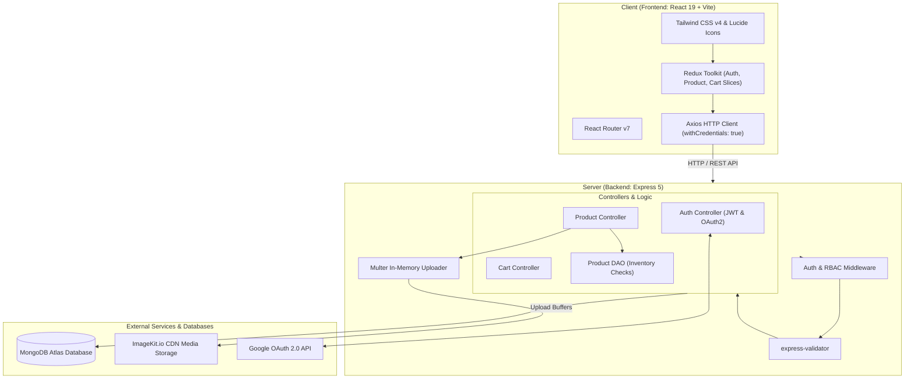

# 🛒 Snitch — Full-Stack E-Commerce Platform

[](https://nodejs.org/)
[](https://expressjs.com/)
[](https://react.dev/)
[](https://vitejs.dev/)
[](https://www.mongodb.com/)
[](https://tailwindcss.com/)
[](https://redux-toolkit.js.org/)
[](https://imagekit.io/)

A modern, high-performance, full-stack multi-vendor e-commerce platform inspired by the clean, trend-focused streetwear retail experience of **Snitch**. Built with an **Express 5** RESTful backend and a **React 19 + Vite** single-page application frontend.

---

## 📑 Table of Contents

1. [Key Features](#-key-features)
2. [System Architecture](#-system-architecture)
3. [Technology Stack](#-technology-stack)
4. [Project Structure](#-project-structure)
5. [API Reference](#-api-reference)
6. [Environment Variables](#-environment-variables)
7. [Getting Started](#-getting-started)
8. [User Workflows](#-user-workflows)
9. [Deployment](#-deployment)
10. [Engineering Documentation](#-engineering-documentation)

---

## 🌟 Key Features

### 🛍️ Buyer Experience
- **Interactive Storefront**: Browse products with live search (filtering by title, description, or seller) and dynamic price/date sorting.
- **Product Inspection Modal**: Detailed preview featuring image carousels, dynamic variant selector (size, color, custom attributes), real-time pricing, and stock validation.
- **Dynamic Shopping Cart**:
  - Add single items or complex variants.
  - Increment/decrement quantities with atomic inventory/stock constraints verified against the database.
  - Real-time subtotal and item count calculations.
  - Multi-path item removal endpoints for seamless UI interactions.

### 🏪 Seller Hub & Dashboard
- **Seller Management**: Dedicated dashboard for sellers to manage their inventory.
- **Product Creation Suite**:
  - Multi-image uploads (up to 7 images per product) processed via Multer memory storage and delivered through ImageKit CDN.
  - Support for cover images and variant-specific media.
  - Dynamic variant and attribute matrix builder (size, color, custom attributes, independent pricing, and stock tracking).
- **Product Life Cycle**: Update details or securely delete products with automated ImageKit cloud media cleanup.

### 🔐 Authentication & Security
- **Dual Authentication**: Native JWT authentication with HTTP-only cookies and Google OAuth 2.0 social login via Passport.js.
- **Role-Based Access Control (RBAC)**: Distinct authorization barriers for `buyer` and `seller` roles across both backend middleware and frontend route guards.
- **Input Sanitization & Validation**: Robust request body validation using `express-validator`.
- **CORS & Proxy Hardening**: Configured for cross-origin credentials and reverse proxies (e.g., Render, Vercel).

---

## 🏗️ System Architecture



---

## 💻 Technology Stack

### Backend
| Technology | Description |
| :--- | :--- |
| **Node.js** | JavaScript runtime (ES Modules) |
| **Express.js 5.x** | Fast, unopinionated web framework for Node |
| **MongoDB & Mongoose 9.x** | Document database and object modeling layer |
| **ImageKit SDK** | Cloud storage and CDN optimization for product images |
| **Passport.js & Google OAuth 2.0** | Third-party single sign-on authentication |
| **JSON Web Token (jsonwebtoken)** | Stateless session authentication |
| **bcrypt** | Salted password hashing |
| **Multer 2.x** | Multipart/form-data handler for uploads |
| **express-validator** | Request body and param validation schema |
| **Morgan & Cookie-Parser** | HTTP logging and cookie parsing |

### Frontend
| Technology | Description |
| :--- | :--- |
| **React 19** | Modern UI library with concurrent features |
| **Vite 8** | Next-generation frontend build tooling & HMR |
| **Redux Toolkit & React-Redux** | Centralized global state management |
| **React Router v7** | Declarative client-side routing & nested layout outlets |
| **Tailwind CSS v4** | Utility-first CSS framework |
| **Lucide React** | Clean, consistent icons |
| **Axios** | Promise-based HTTP client |
| **Oxlint** | High-performance Rust-based JavaScript linter |

---

## 📁 Project Structure

```text
Snitch/
├── Backend/                         # Express.js REST API Server
│   ├── src/
│   │   ├── config/                  # App configurations (DB, ImageKit, Environment)
│   │   │   ├── config.js
│   │   │   └── db.js
│   │   ├── controllers/             # Request handlers
│   │   │   ├── auth.controller.js
│   │   │   ├── cart.controller.js
│   │   │   └── product.contoller.js
│   │   ├── dao/                     # Data Access Objects (Inventory / Stock queries)
│   │   │   └── product.dao.js
│   │   ├── middleweres/             # Auth, upload, and validation middleware
│   │   │   ├── auth.middleweres.js
│   │   │   ├── upload.middleware.js
│   │   │   └── validate.js
│   │   ├── models/                  # Mongoose data schemas
│   │   │   ├── cart.model.js
│   │   │   ├── price.schema.js
│   │   │   ├── product.model.js
│   │   │   └── user.model.js
│   │   ├── routes/                  # Express route definitions
│   │   │   ├── auth.routes.js
│   │   │   ├── cart.routes.js
│   │   │   └── product.routes.js
│   │   ├── services/                # External service wrappers
│   │   │   └── storage.service.js   # ImageKit upload/delete handler
│   │   ├── validator/               # express-validator schemas
│   │   │   ├── auth.validator.js
│   │   │   ├── cart.validator.js
│   │   │   └── product.validator.js
│   │   └── app.js                   # Express application setup
│   ├── server.js                    # Server startup script
│   └── package.json
│
├── Frontend/                        # React 19 Single Page Application
│   ├── src/
│   │   ├── app/                     # Router and Store initialization
│   │   │   ├── App.jsx
│   │   │   ├── app.routers.jsx
│   │   │   └── app.store.js
│   │   ├── features/                # Feature-sliced modules
│   │   │   ├── auth/                # Login, Register, Protected route wrappers
│   │   │   ├── cart/                # Cart page, hooks, services, state
│   │   │   └── products/            # Storefront, Seller Dashboard, Product Modals
│   │   ├── shared/                  # Reusable components (Navbar, UI elements)
│   │   │   └── components/
│   │   ├── main.jsx                 # React root render
│   │   └── index.css                # Tailwind CSS imports
│   ├── index.html
│   ├── vite.config.js
│   └── package.json
│
└── Docs/                            # Exhaustive Technical Documentation
    ├── AUTHENTICATION_HANDBOOK.md   # Complete 27-section authentication manual
    ├── Google_authentication.md     # Google OAuth 2.0 flow & debugging guide
    ├── Home_page_docs.md            # Detailed Home/Storefront component guide
    └── product_creation_backend_api_documentation.md # Product API reference
```

---

## 📡 API Reference

### 🔐 Authentication (`/api/auth`)

| Method | Endpoint | Auth | Description |
| :--- | :--- | :---: | :--- |
| `POST` | `/api/auth/register` | None | Register a new user (`buyer` or `seller`) |
| `POST` | `/api/auth/login` | None | Authenticate with email/password; sets HTTP-only cookie |
| `GET` | `/api/auth/google` | None | Initiates Google OAuth 2.0 consent screen |
| `GET` | `/api/auth/google/callback` | None | Google OAuth callback; issues token and redirects |
| `GET` | `/api/auth/me` | Bearer/Cookie | Retrieve current authenticated user profile |

### 📦 Products (`/api/products`)

| Method | Endpoint | Auth | Role | Description |
| :--- | :--- | :---: | :---: | :--- |
| `GET` | `/api/products` | None | Any | List all products across all sellers |
| `GET` | `/api/products/:id` | None | Any | Retrieve a single product by ID |
| `GET` | `/api/products/seller` | Required | Seller | Fetch all products owned by current seller |
| `POST` | `/api/products` | Required | Seller | Create a product with multi-image uploads |
| `PUT` | `/api/products/seller/:id` | Required | Seller | Update product details & media |
| `DELETE` | `/api/products/seller/:id` | Required | Seller | Delete product and clean up ImageKit media |

### 🛒 Cart (`/api/cart`)

| Method | Endpoint | Auth | Description |
| :--- | :--- | :---: | :--- |
| `GET` | `/api/cart` | Required | Fetch current user's cart with populated items |
| `POST` | `/api/cart/add/:productId/:variantId?` | Required | Add product or specific variant to cart |
| `POST`/`PATCH` | `/api/cart/quantity/increment/:productId/:variantId?` | Required | Increment item quantity (checks variant stock) |
| `POST`/`PATCH` | `/api/cart/quantity/decrement/:productId/:variantId?` | Required | Decrement item quantity |
| `DELETE` | `/api/cart/remove/:productId/:variantId?` | Required | Remove item from cart by Product/Variant ID |
| `DELETE` | `/api/cart/item-id/:itemId` | Required | Remove item from cart by Cart Item subdocument ID |

---

## ⚙️ Environment Variables

### Backend Configuration (`Backend/.env`)
Create a `.env` file in the `Backend` directory:

```env
# Server Configuration
PORT=3000
NODE_ENV=development

# Database Connection
MONGO_URI=mongodb+srv://<username>:<password>@cluster0.mongodb.net/snitch?retryWrites=true&w=majority

# Authentication Secrets
JWT_SECRET=your_super_secret_jwt_key_here

# Google OAuth 2.0 Credentials
GOOGLE_CLIENT_ID=your_google_client_id.apps.googleusercontent.com
GOOGLE_CLIENT_SECRET=your_google_client_secret

# Origin URLs
CLIENT_URL=http://localhost:5173
SERVER_URL=http://localhost:3000

# Cloud Media Storage (ImageKit.io)
IMAGEKIT_PRIVATE_KEY=your_imagekit_private_key
```

### Frontend Configuration (`Frontend/.env`)
Create a `.env` file in the `Frontend` directory:

```env
# Backend Base API URL
VITE_API_URL=http://localhost:3000
```

---

## 🚀 Getting Started

### Prerequisites
- [Node.js](https://nodejs.org/) (v18.0.0 or higher)
- [npm](https://www.npmjs.com/) (v9.0.0 or higher)
- A running [MongoDB](https://www.mongodb.com/) instance or MongoDB Atlas URI
- An [ImageKit](https://imagekit.io/) account for image uploads
- Google Cloud Console project with OAuth 2.0 Client ID enabled (optional for Google Login)

---

### Step 1: Clone the Repository
```bash
git clone https://github.com/Rohit273848/Snitch.git
cd Snitch
```

---

### Step 2: Set Up Backend
```bash
cd Backend

# 1. Install dependencies
npm install

# 2. Configure environment variables
# Copy or create your .env file with the variables listed above

# 3. Start the backend in development mode
npm run dev
```
> The backend server will start on `http://localhost:3000` (or the PORT defined in your `.env`).

---

### Step 3: Set Up Frontend
In a separate terminal window:
```bash
cd Frontend

# 1. Install dependencies
npm install

# 2. Configure environment variables
# Ensure .env contains: VITE_API_URL=http://localhost:3000

# 3. Start the Vite dev server
npm run dev
```
> The frontend client will run on `http://localhost:5173`.

---

## 🔄 User Workflows

```text
             ┌─────────────────────────┐
             │       Landing / Nav     │
             └────────────┬────────────┘
                          │
            ┌─────────────┴─────────────┐
            ▼                           ▼
    [ Register / Login ]       [ Browse Catalog ]
            │                           │
  ┌─────────┴─────────┐                 │
  ▼                   ▼                 ▼
(Buyer)            (Seller)      [ Product Modal ]
  │                   │                 │
  │                   ▼                 ▼
  │          [ Seller Dashboard ]  [ Add To Cart ]
  │          - Create Products          │
  │          - Multi-Image Upload       ▼
  │          - Variant Management  [ Cart Page ]
  │          - Stock Management    - Increment / Decrement
  ▼                                - Remove Items
[ Checkout Flow ]                  - Total Calculation
```

---

## 🌐 Deployment

### Backend (Render)
1. Set the root directory to `Backend`.
2. Build Command: `npm install`
3. Start Command: `node server.js`
4. Add all environment variables from `Backend/.env` in the Render Environment tab.
5. Set `SERVER_URL` to your Render app URL (e.g., `https://snitch-api.onrender.com`) and `CLIENT_URL` to your frontend production domain.
6. The app includes `app.set("trust proxy", 1)` to support HTTPS secure cookies on reverse proxies.

### Frontend (Vercel)
1. Set the root directory to `Frontend`.
2. Build Command: `npm run build`
3. Output Directory: `dist`
4. Configure `VITE_API_URL` to point to the live backend URL.
5. A `vercel.json` file is included in `Frontend/` for proper SPA route rewrites:
   ```json
   {
     "rewrites": [{ "source": "/(.*)", "destination": "/" }]
   }
   ```

---

## 📚 Engineering Documentation

The repository includes detailed guides and architecture manuals in the [`Docs/`](./Docs) folder:

- **[🔐 Authentication Architecture & Implementation Handbook](./Docs/AUTHENTICATION_HANDBOOK.md)**:
  - 27-section comprehensive manual detailing JWT security, refresh lifecycles, cookies, Passport integration, and error resolution.
- **[🌐 Google Authentication Guide](./Docs/Google_authentication.md)**:
  - Complete walkthrough for Google Cloud Console setup, redirect URI handling, and cross-origin cookies.
- **[💻 Storefront & Home Component Documentation](./Docs/Home_page_docs.md)**:
  - In-depth architectural explanation of `Home.jsx`, product filtering, skeleton loaders, and Redux data subscriptions.
- **[📝 Product Creation API Specification](./Docs/product_creation_backend_api_documentation.md)**:
  - Detailed payload specs, multipart file handling, validation rules, and variant schema documentation.

---

## 📄 License

This project is licensed under the [ISC License](https://opensource.org/licenses/ISC).
