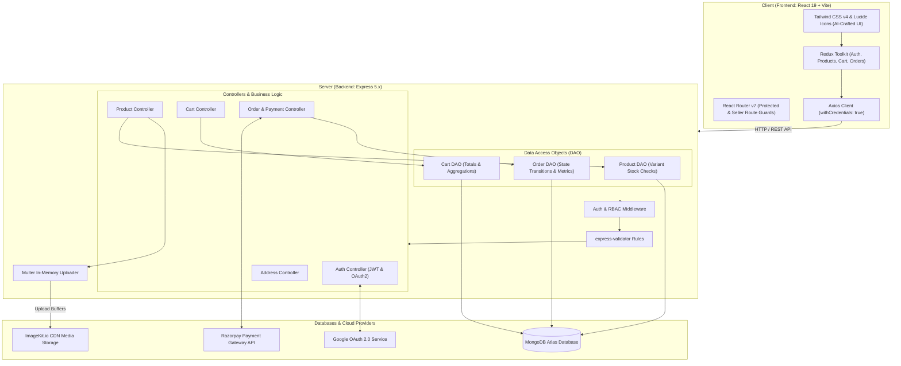
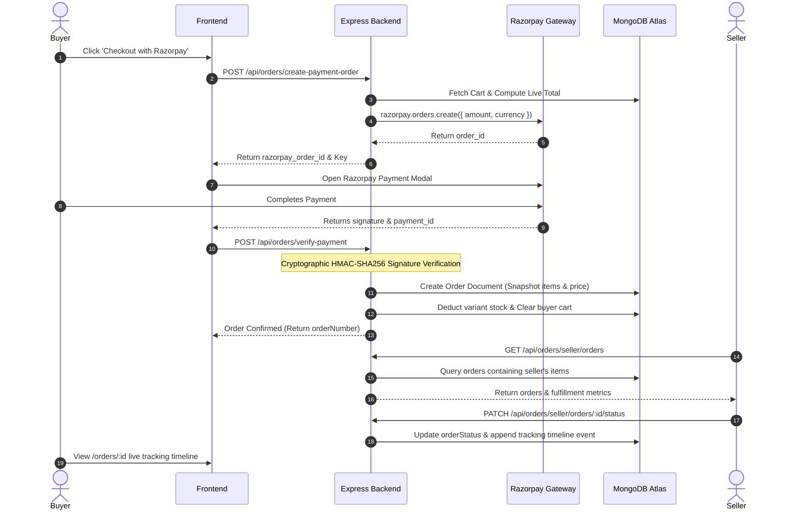

# 🛒 Velmora — Full-Stack Multi-Vendor E-Commerce Platform

[](https://nodejs.org/)
[](https://expressjs.com/)
[](https://react.dev/)
[](https://vitejs.dev/)
[](https://www.mongodb.com/)
[](https://tailwindcss.com/)
[](https://redux-toolkit.js.org/)
[](https://razorpay.com/)
[](https://imagekit.io/)

A modern, high-performance, full-stack multi-vendor e-commerce platform inspired by the bold, minimalist architectural aesthetic of **Velmora**. The platform provides an end-to-end shopping and selling experience: featuring real-time catalog discovery, dynamic variant management, atomic cart validation, multi-address shipping, Razorpay payment processing, and live order tracking.

The user interface was crafted and refined using **AI-assisted modern UI engineering**, delivering rich micro-interactions, responsive layouts, and a luxury streetwear design system.

---

## 📑 Table of Contents

1. [🌟 Key Features](#-key-features)
2. [🏗️ System Architecture](#-system-architecture)
3. [🔄 Order & Fulfillment Lifecycle](#-order--fulfillment-lifecycle)
4. [💡 What I Learned from This Project](#-what-i-learned-from-this-project)
   - [Backend Engineering Deep Dive](#-backend-engineering-deep-dive)
   - [AI-Assisted UI Engineering](#-ai-assisted-ui-engineering)
5. [💻 Technology Stack](#-technology-stack)
6. [📁 Project Structure](#-project-structure)
7. [📡 Complete API Reference](#-complete-api-reference)
8. [⚙️ Environment Variables](#-environment-variables)
9. [🚀 Getting Started & Local Setup](#-getting-started--local-setup)
10. [🌐 Production Deployment](#-production-deployment)
11. [📚 Engineering Documentation](#-engineering-documentation)
12. [📄 License](#-license)

---

## 🌟 Key Features

### 🛍️ Buyer Experience
- **Interactive Storefront**: Explore collections with live search (filtering by title, description, or seller) and dynamic price/date sorting.
- **Product Inspection Modal**: Deep-dive product preview with multi-image carousels, dynamic variant selectors (color, size, SKU), live price calculations, and real-time inventory validation.
- **Dynamic Shopping Cart**:
  - Add products with specific variant combinations (size, color, custom attributes).
  - Increment/decrement quantities with server-validated stock ceilings to prevent overselling.
  - Multi-path item removals with immediate optimistic UI updates.
- **Address & Delivery Book**:
  - Save, edit, and organize multiple delivery addresses (Home, Work, Other).
  - Instant address selection synchronized with the active cart for frictionless checkout.
- **Seamless Checkout & Payments**:
  - **Razorpay Payment Gateway**: Secure modal payment flow with cryptographic HMAC-SHA256 signature verification.
  - **Cash on Delivery (COD)**: Alternative frictionless checkout path.
- **Live Order Tracking**:
  - Visual shipment progress stepper (Placed $\rightarrow$ Confirmed $\rightarrow$ Processing $\rightarrow$ Shipped $\rightarrow$ Out for Delivery $\rightarrow$ Delivered).
  - Detailed audit logs, carrier tracking numbers, and cancellation triggers with inventory restocking safeguards.

### 🏪 Seller Studio & Merchant Operations
- **Merchant Dashboard**: Real-time sales telemetry including gross revenue, pending fulfillment counts, orders in transit, and active catalog statistics.
- **Product Creation & Variant Matrix**:
  - Multi-image uploads (up to 7 images per product) processed in-memory and hosted on **ImageKit CDN**.
  - Flexible variant matrix supporting independent pricing, stock levels, and SKUs per variant combination.
  - Dedicated cover image assignment and automated media optimization.
- **Seller Order Fulfillment Pipeline**:
  - Dedicated seller orders view displaying item-level sub-totals, customer contact information, and shipping destinations.
  - Milestone progression manager: Transition orders from `PLACED` $\rightarrow$ `PROCESSING` $\rightarrow$ `SHIPPED` $\rightarrow$ `DELIVERED`.
  - Automated carrier assignment and courier tracking updates.

### 🔐 Security & Identity
- **Dual Authentication**: Native email/password authentication using salted bcrypt hashing alongside Google OAuth 2.0 social login via Passport.js.
- **Stateless Session Security**: JWT tokens stored in tamper-proof, secure HTTP-only cookies.
- **Role-Based Access Control (RBAC)**: Strict barrier middleware segregating `buyer` and `seller` privileges on both frontend routes and backend endpoints.
- **Input Sanitization & Validation**: Comprehensive request validation schemas powered by `express-validator`.
- **CORS & Proxy Hardening**: Configured for cross-origin credentials and reverse proxies (Render, Vercel).

---

## 🏗️ System Architecture



---

## 🔄 Order & Fulfillment Lifecycle



---

## 💡 What I Learned from This Project

Building **Velmora** was a comprehensive end-to-end engineering journey that went far beyond basic CRUD applications. It provided deep, practical mastery over distributed backend architectures, real-world e-commerce edge cases, payment security, and state-of-the-art UI craftsmanship.

### 🛡️ Backend Engineering Deep Dive

#### 1. Multi-Vendor Data Modeling & Historical Snapshots
- **The Challenge**: In a multi-vendor platform, products, variants, and prices are dynamic. If a seller modifies a product title, updates pricing, or deletes a product after an order is placed, past customer orders must remain immutable and audit-compliant.
- **The Solution**:
  - Implemented an **Order Snapshot Schema**: When an order is placed, complete snapshots of variant details (`size`, `color`, `sku`), title, cover image, and the exact unit price at that exact second are frozen into the `orderItemSchema`.
  - Added multi-seller array indexing (`sellers: [ObjectId]`) and per-item seller attribution (`item.seller`), allowing sellers to view and fulfill only their respective sub-orders without leaking third-party vendor data.

#### 2. Cryptographic Payment Verification (Razorpay + HMAC-SHA256)
- **The Challenge**: Client-side payment callbacks cannot be trusted blindly. A malicious actor could spoof success responses or alter order amounts.
- **The Solution**:
  - Built a two-phase checkout handshake:
    1. The backend dynamically calculates the order total from the live database cart and generates an official Razorpay Order ID.
    2. Upon checkout completion, the backend cryptographically validates the signature using `crypto.createHmac("sha256", secret)` over `${razorpay_order_id}|${razorpay_payment_id}`.
  - Only upon mathematical proof of signature match does the server generate the order, decrement stock, and empty the cart.

#### 3. Atomic Inventory Constraints & Variant stock resolution
- **The Challenge**: Preventing race conditions, overselling, and negative inventory counts when multiple buyers attempt to purchase limited variant quantities.
- **The Solution**:
  - Built a dedicated Data Access Object (`product.dao.js`) with positional array matching (`variants.$`) to verify current variant stock against requested cart modifications.
  - Enforced strict stock ceilings on quantity increments (`/api/cart/quantity/increment`) before committing changes to the database.

#### 4. Dual-Authentication & Secure Stateless Sessions
- **The Challenge**: Providing both standard credentials authentication and frictionless Google OAuth 2.0 social login, while mitigating XSS (Cross-Site Scripting) and CSRF (Cross-Site Request Forgery) attacks.
- **The Solution**:
  - Integrated `passport-google-oauth20` alongside native JWT token generation.
  - Stored JWTs in `httpOnly`, `sameSite: "lax"`, `secure` (in production) cookies, completely inaccessible to browser JavaScript.
  - Added `app.set("trust proxy", 1)` and custom path normalizers to ensure HTTPS cookie transmission across reverse-proxy cloud hosting environments like Render.

#### 5. Streaming Cloud Media Management (ImageKit CDN + Multer)
- **The Challenge**: Storing product images locally consumes server disk and degrades performance. Furthermore, deleting a product often leaves orphaned files consuming cloud storage.
- **The Solution**:
  - Utilized `multer.memoryStorage()` to keep incoming multipart file streams in RAM buffers without writing temporary files to disk.
  - Uploaded directly to ImageKit CDN via official SDK with tagging and folder hierarchies.
  - Implemented a clean teardown hook: When a product is deleted (`DELETE /api/products/seller/:id`), all associated ImageKit file IDs are extracted and wiped from the cloud storage in bulk.

#### 6. Architectural Separation of Concerns (Layered Clean Architecture)
- Organized the backend into cleanly segregated layers:
  - **Routes**: Declarative endpoint definitions with route parameters.
  - **Middleware**: Authentication guards (`authenticateUser`, `authenticateSeller`) and multipart upload parsers.
  - **Validators**: Schema validation rules (`express-validator`) executed before hitting handlers.
  - **Controllers**: Request parsing, response formatting, and HTTP status codes.
  - **DAO (Data Access Objects)**: Raw database queries, aggregations, and business logic calculations.
  - **Services**: Third-party API wrappers (ImageKit, Razorpay).

---

### 🎨 AI-Assisted UI Engineering

The user interface of Velmora was built and iterated using **AI pair-programming**, proving how modern AI tools can accelerate frontend development from basic prototypes to production-grade, aesthetically stunning experiences.

#### 1. Premium Streetwear Design System
- Rather than settling for default CSS layouts, AI was leveraged to create a tailored design system inspired by luxury fashion retailers:
  - High-contrast monochromatic color palettes (deep blacks, slate grays, pristine whites) paired with subtle borders (`border-neutral-200 / border-neutral-800`).
  - Sleek micro-interactions: card elevation on hover, smooth drawer transitions, skeleton loaders, and interactive image carousels.

#### 2. Rapid Prototyping of Complex UI States
- **Dynamic Variant Matrix Builder**: AI pair-programming enabled fast iteration of the seller's variant creator (`CreateProduct.jsx` and `SellerProductModel.jsx`), handling complex nested state structures (size arrays, color chips, per-variant price inputs) with ease.
- **Visual Shipment Stepper**: Implemented the live order tracking timeline (`OrderTrackingPage.jsx`) complete with color-coded status badges, real-time date formatting, and courier telemetry.
- **Seller Analytics Hub**: Generated responsive analytical widgets in `SellerOrdersPage.jsx` displaying total earnings, pending fulfillment indicators, and transit filters.

#### 3. State Management & Optimistic UI
- Engineered seamless Redux Toolkit slices (`authSlice`, `cartSlice`, `productSlice`) with AI-assisted debugging of complex state synchronizations.
- Integrated optimistic UI updates so that cart item counts and subtotal values respond instantaneously to user clicks while background API calls resolve.

---

## 💻 Technology Stack

### Backend Technologies
| Technology | Category | Purpose |
| :--- | :--- | :--- |
| **Node.js** | Runtime | Asynchronous JavaScript runtime environment (ES Modules) |
| **Express.js 5.x** | Web Framework | REST API routing, custom middleware, and error handling |
| **MongoDB & Mongoose 9.x** | Database & ODM | Schema validation, subdocuments, references, and aggregation pipelines |
| **Razorpay SDK** | Payment Gateway | Server-side order creation and cryptographic signature verification |
| **ImageKit SDK** | Cloud Storage | Cloud media CDN storage, transformation, and automated asset cleanup |
| **Passport.js & Google OAuth 2.0**| Authentication | Single sign-on social authentication flow |
| **JSON Web Tokens (JWT)** | Authorization | Stateless, tamper-proof session tokens delivered via HTTP-only cookies |
| **bcrypt** | Cryptography | Industry-standard password hashing with salt rounds |
| **Multer 2.x** | File Handling | Memory storage buffering for multi-image product uploads |
| **express-validator** | Security | Input validation and sanitization for request payloads |
| **Morgan & Cookie-Parser** | Utilities | HTTP request logging and cookie parsing |

### Frontend Technologies
| Technology | Category | Purpose |
| :--- | :--- | :--- |
| **React 19** | UI Library | Modern component hierarchy, hooks, and concurrent features |
| **Vite 8** | Build Tooling | High-speed Hot Module Replacement (HMR) and optimized bundling |
| **Tailwind CSS v4** | Styling | Utility-first CSS engine powering the streetwear design system |
| **Redux Toolkit & React-Redux** | State Management | Global state management for authentication, cart items, and catalog |
| **React Router v7** | Client Routing | Declarative routing with nested layouts and protected route guards |
| **Lucide React** | Icons | Modern, consistent icon library |
| **Axios** | HTTP Client | Promise-based HTTP client with global interceptors and cookie support |
| **Oxlint** | Code Quality | High-performance Rust-based JavaScript linter |

---

## 📁 Project Structure

```text
Snitch/
├── Backend/                         # Express.js REST API Server
│   ├── src/
│   │   ├── config/                  # Configuration modules
│   │   │   ├── config.js            # Environment variables & constants
│   │   │   └── db.js                # MongoDB connection handler
│   │   ├── controllers/             # HTTP request & response handlers
│   │   │   ├── address.controller.js# Address book & cart-address mapping
│   │   │   ├── auth.controller.js   # Registration, Login, OAuth callback
│   │   │   ├── cart.controller.js   # Cart additions, quantities, removals
│   │   │   ├── order.controller.js  # Razorpay orders, COD, Tracking, Seller orders
│   │   │   └── product.contoller.js # Product CRUD, multi-image upload
│   │   ├── dao/                     # Data Access Objects (Database operations)
│   │   │   ├── cart.dao.js          # Cart aggregation & calculations
│   │   │   ├── order.dao.js         # Order generation, stock updates & seller metrics
│   │   │   └── product.dao.js       # Variant stock queries
│   │   ├── middleweres/             # Custom Express middleware
│   │   │   ├── auth.middleweres.js  # JWT validation & Seller RBAC guards
│   │   │   ├── upload.middleware.js # Multer in-memory upload configurations
│   │   │   └── validate.js          # express-validator result inspector
│   │   ├── models/                  # Mongoose document schemas
│   │   │   ├── address.model.js     # User shipping address schema
│   │   │   ├── cart.model.js        # User shopping cart schema
│   │   │   ├── order.model.js       # Order, OrderItems, & Tracking event schema
│   │   │   ├── price.schema.js      # Reusable price subdocument schema
│   │   │   ├── product.model.js     # Product & variant matrix schema
│   │   │   └── user.model.js        # User identity & roles schema
│   │   ├── routes/                  # Express route definitions
│   │   │   ├── address.routes.js    # /api/address endpoints
│   │   │   ├── auth.routes.js       # /api/auth endpoints
│   │   │   ├── cart.routes.js       # /api/cart endpoints
│   │   │   ├── order.routes.js      # /api/orders endpoints
│   │   │   └── product.routes.js    # /api/products endpoints
│   │   ├── scripts/                 # Database seeders & utilities
│   │   │   └── seedProducts.js      # Initial catalog seeder script
│   │   ├── services/                # External service integrations
│   │   │   ├── payment.service.js   # Razorpay instance & HMAC verifier
│   │   │   └── storage.service.js   # ImageKit upload & delete operations
│   │   ├── validator/               # express-validator schemas
│   │   │   ├── address.validator.js
│   │   │   ├── auth.validator.js
│   │   │   ├── cart.validator.js
│   │   │   └── product.validator.js
│   │   └── app.js                   # Express app setup, CORS, and root middlewares
│   ├── server.js                    # Server entrypoint (Port listener)
│   └── package.json
│
├── Frontend/                        # React 19 Single Page Application
│   ├── src/
│   │   ├── app/                     # Core application configurations
│   │   │   ├── App.jsx              # Main App root component
│   │   │   ├── app.routers.jsx      # React Router route registry
│   │   │   └── app.store.js         # Centralized Redux store configuration
│   │   ├── features/                # Feature-Sliced modules
│   │   │   ├── auth/                # Authentication slice, pages, and route guards
│   │   │   │   ├── components/      # Protected.jsx, SellerProtected.jsx
│   │   │   │   ├── pages/           # Login.jsx, Register.jsx
│   │   │   │   └── state/           # authSlice.js
│   │   │   ├── cart/                # Shopping cart feature
│   │   │   │   ├── components/      # Cart item cards, checkout summary
│   │   │   │   ├── pages/           # CartPage.jsx (Address selector & order triggers)
│   │   │   │   └── state/           # cartSlice.js
│   │   │   ├── orders/              # Orders & fulfillment feature
│   │   │   │   ├── pages/           # OrdersListPage, OrderTrackingPage, OrderSuccessPage, SellerOrdersPage
│   │   │   │   └── services/        # Order API calls & payment triggers
│   │   │   └── products/            # Catalog, discovery, and seller studio
│   │   │       ├── pages/           # Home, SearchResultsPage, ProductModal, CreateProduct, SellerDashboard, SellerProduct, SellerProductModel
│   │   │       └── state/           # productSlice.js
│   │   ├── shared/                  # Reusable UI components
│   │   │   └── components/          # Nav.jsx, Footer.jsx, Badges, Modals
│   │   ├── main.jsx                 # React root render
│   │   └── index.css                # Tailwind CSS imports & global styles
│   ├── index.html
│   ├── vite.config.js
│   └── package.json
│
└── Docs/                            # In-Depth Architectural Documentation
    ├── AUTHENTICATION_HANDBOOK.md   # Comprehensive 27-section authentication manual
    ├── Google_authentication.md     # Google OAuth 2.0 flow & credential setup
    ├── Home_page_docs.md            # Detailed Storefront & Home documentation
    └── product_creation_backend_api_documentation.md # Product API reference
```

---

## 📡 Complete API Reference

### 🔐 Authentication (`/api/auth`)
| Method | Endpoint | Auth | Role | Description |
| :--- | :--- | :---: | :---: | :--- |
| `POST` | `/api/auth/register` | None | Public | Register new user account (`buyer` or `seller`) |
| `POST` | `/api/auth/login` | None | Public | Authenticate credentials; sets secure HTTP-only cookie |
| `GET` | `/api/auth/google` | None | Public | Redirects to Google OAuth 2.0 consent screen |
| `GET` | `/api/auth/google/callback` | None | Public | Google OAuth callback; issues JWT and redirects to client |
| `GET` | `/api/auth/me` | Required | Any | Retrieve profile data for current authenticated session |

### 📦 Products & Catalog (`/api/products`)
| Method | Endpoint | Auth | Role | Description |
| :--- | :--- | :---: | :---: | :--- |
| `GET` | `/api/products` | None | Public | Fetch all public products with pagination & search |
| `GET` | `/api/products/:id` | None | Public | Retrieve detailed product data including variants |
| `GET` | `/api/products/seller` | Required | Seller | Fetch all products owned by current authenticated seller |
| `POST` | `/api/products` | Required | Seller | Create a new product with multi-image CDN upload |
| `PUT` | `/api/products/seller/:id` | Required | Seller | Update product details, pricing, and variant matrix |
| `DELETE`| `/api/products/seller/:id` | Required | Seller | Delete product and automatically purge ImageKit CDN files |

### 🛒 Shopping Cart (`/api/cart`)
| Method | Endpoint | Auth | Role | Description |
| :--- | :--- | :---: | :---: | :--- |
| `GET` | `/api/cart` | Required | Buyer | Retrieve user's cart with populated item & variant details |
| `POST` | `/api/cart/add/:productId/:variantId?` | Required | Buyer | Add item or variant to cart with stock validation |
| `PATCH`| `/api/cart/quantity/increment/:productId/:variantId?`| Required | Buyer | Increment quantity (enforces available stock limit) |
| `PATCH`| `/api/cart/quantity/decrement/:productId/:variantId?`| Required | Buyer | Decrement item quantity |
| `DELETE`| `/api/cart/remove/:productId/:variantId?` | Required | Buyer | Remove specific product/variant from cart |
| `DELETE`| `/api/cart/item-id/:itemId` | Required | Buyer | Remove item directly using cart item subdocument ID |

### 📍 Addresses (`/api/address`)
| Method | Endpoint | Auth | Role | Description |
| :--- | :--- | :---: | :---: | :--- |
| `GET` | `/api/address` | Required | Buyer | List all saved delivery addresses for authenticated user |
| `POST` | `/api/address` | Required | Buyer | Save a new delivery address |
| `PUT` | `/api/address/:addressId` | Required | Buyer | Update an existing address |
| `DELETE`| `/api/address/:addressId` | Required | Buyer | Delete an address |
| `POST` | `/api/address/select/:addressId` | Required | Buyer | Select active shipping address for current cart |
| `DELETE`| `/api/address/select` | Required | Buyer | Clear selected address from cart |

### 💳 Orders & Payments (`/api/orders`)
| Method | Endpoint | Auth | Role | Description |
| :--- | :--- | :---: | :---: | :--- |
| `POST` | `/api/orders/create-payment-order` | Required | Buyer | Create Razorpay order calculated from active cart total |
| `POST` | `/api/orders/verify-payment` | Required | Buyer | Verify HMAC signature, place order, and decrement stock |
| `POST` | `/api/orders/checkout/cod` | Required | Buyer | Place order via Cash on Delivery |
| `GET` | `/api/orders/my-orders` | Required | Buyer | Retrieve order history for current buyer |
| `GET` | `/api/orders/track/:orderId` | Required | Buyer | Retrieve real-time tracking timeline & status for an order |
| `PATCH`| `/api/orders/:orderId/cancel` | Required | Buyer | Cancel order and trigger automated stock restoration |
| `GET` | `/api/orders/seller/orders` | Required | Seller | Fetch orders containing seller's items + revenue metrics |
| `PATCH`| `/api/orders/seller/orders/:orderId/status` | Required | Seller | Update order milestone (`PROCESSING`, `SHIPPED`, etc.) |

---

## ⚙️ Environment Variables

### Backend Configuration (`Backend/.env`)
Create a `.env` file in the `Backend/` directory:

```env
# Server Port & Mode
PORT=3000
NODE_ENV=development

# Database Connection (MongoDB Atlas)
MONGO_URI=mongodb+srv://<username>:<password>@cluster0.mongodb.net/velmora?retryWrites=true&w=majority

# JWT Token Secret
JWT_SECRET=your_super_secure_jwt_secret_key_here

# Google OAuth 2.0 Credentials
GOOGLE_CLIENT_ID=your_google_client_id.apps.googleusercontent.com
GOOGLE_CLIENT_SECRET=your_google_client_secret

# Origin URLs
CLIENT_URL=http://localhost:5173
SERVER_URL=http://localhost:3000

# Razorpay Payment Gateway Keys
RAZORPAY_KEY_ID=rzp_test_your_razorpay_key_id
RAZORPAY_KEY_SECRET=your_razorpay_key_secret

# ImageKit.io Cloud Media Storage
IMAGEKIT_PUBLIC_KEY=your_imagekit_public_key
IMAGEKIT_PRIVATE_KEY=your_imagekit_private_key
IMAGEKIT_URL_ENDPOINT=https://ik.imagekit.io/your_id
```

### Frontend Configuration (`Frontend/.env`)
Create a `.env` file in the `Frontend/` directory:

```env
# Backend REST API Base URL
VITE_API_URL=http://localhost:3000

# Razorpay Public Key ID (for client checkout popup)
VITE_RAZORPAY_KEY_ID=rzp_test_your_razorpay_key_id
```

---

## 🚀 Getting Started & Local Setup

### Prerequisites
- [Node.js](https://nodejs.org/) (v18.0.0 or higher)
- [npm](https://www.npmjs.com/) (v9.0.0 or higher)
- MongoDB instance (Local or [MongoDB Atlas](https://www.mongodb.com/atlas))
- Free accounts for:
  - [ImageKit.io](https://imagekit.io/) (Image uploads)
  - [Razorpay](https://razorpay.com/) (Test mode payment credentials)
  - [Google Cloud Console](https://console.cloud.google.com/) (OAuth Client ID)

---

### Step 1: Clone the Repository
```bash
git clone https://github.com/Rohit273848/Snitch.git
cd Snitch
```

---

### Step 2: Set Up & Run Backend
```bash
# Navigate to the backend directory
cd Backend

# 1. Install dependencies
npm install

# 2. Configure environment variables
# Create a .env file and paste the backend environment variables listed above

# 3. Optional: Seed initial sample streetwear products into MongoDB
npm run seed

# 4. Start the backend development server
npm run dev
```
> The API server will be live on `http://localhost:3000`.

---

### Step 3: Set Up & Run Frontend
In a new terminal window:
```bash
# Navigate to the frontend directory
cd Frontend

# 1. Install dependencies
npm install

# 2. Configure environment variables
# Create a .env file and verify VITE_API_URL=http://localhost:3000

# 3. Start the Vite development server
npm run dev
```
> The web application will launch at `http://localhost:5173`.

---

## 🌐 Production Deployment

### Backend (Render / Railway / EC2)
1. **Root Directory**: `Backend`
2. **Build Command**: `npm install`
3. **Start Command**: `node server.js`
4. Add all environment variables from `Backend/.env` into your host provider's dashboard.
5. Set `CLIENT_URL` to your production frontend domain (e.g. `https://velmora-store.vercel.app`) and `SERVER_URL` to your backend URL.
6. The app includes `app.set("trust proxy", 1)` ensuring secure HTTPS cookies are processed correctly behind load balancers.

### Frontend (Vercel / Netlify)
1. **Root Directory**: `Frontend`
2. **Framework Preset**: `Vite`
3. **Build Command**: `npm run build`
4. **Output Directory**: `dist`
5. Configure `VITE_API_URL` to point to the production API URL.
6. SPA rewrites are pre-configured in `Frontend/vercel.json`:
   ```json
   {
     "rewrites": [{ "source": "/(.*)", "destination": "/" }]
   }
   ```

---

## 📚 Engineering Documentation

The [`Docs/`](./Docs) folder contains in-depth architectural whitepapers detailing key systems within the platform:

- **[🔐 Authentication Architecture & Implementation Handbook](./Docs/AUTHENTICATION_HANDBOOK.md)**:
  - 27-section manual covering JWT lifecycles, cookie security, Passport.js OAuth integration, and production troubleshooting.
- **[🌐 Google Authentication Guide](./Docs/Google_authentication.md)**:
  - Complete walkthrough for Google Cloud Console setup, callback redirect URIs, and cross-origin cookie credentials.
- **[💻 Storefront & Home Component Documentation](./Docs/Home_page_docs.md)**:
  - In-depth architectural guide for `Home.jsx`, catalog filters, skeleton loaders, and Redux data subscriptions.
- **[📝 Product Creation API Specification](./Docs/product_creation_backend_api_documentation.md)**:
  - Multipart upload specifications, validation rules, and variant schema design.

---

## 📄 License

This project is licensed under the [ISC License](https://opensource.org/licenses/ISC).
